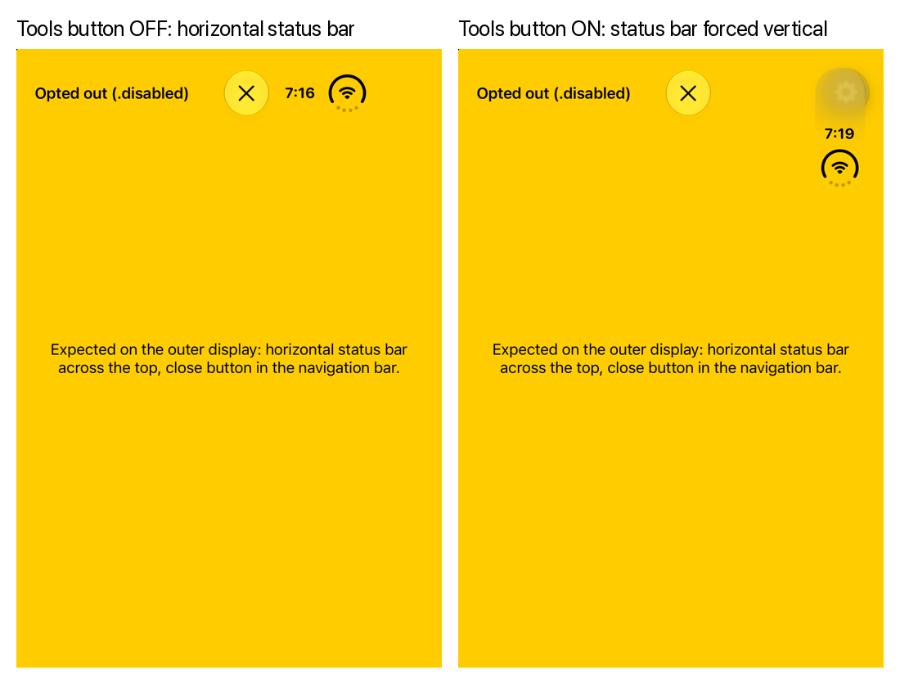

# expo-dev-menu floating button forces the vertical status bar (iPhone Duo)

Minimal reproduction for an `expo-dev-menu` issue on iOS 27.1 / iPhone Duo.

On the iPhone Duo's outer display, iOS 27.1 lays bar items and the status bar out in a vertical bar. A view controller can opt out with [`preferredVerticalBarBehavior = .disabled`](https://developer.apple.com/documentation/uikit/uiviewcontroller/preferredverticalbarbehavior). For a full-screen presentation, the status bar then returns to the horizontal axis.

While the dev menu's floating **Tools button** is shown, the opt-out no longer reaches the status bar: it stays vertical. The navigation bar still honors the opt-out. Hiding the Tools button fixes it.

## What's in the app

- `modules/vertical-bar-probe`: a local Expo module that presents a full-screen `UINavigationController` whose content returns `preferredVerticalBarBehavior = .disabled` (or `.automatic`). It is plain UIKit, with no navigation library involved.
- `App.tsx`: buttons to present it, plus a shortcut that toggles the dev menu's floating button preference.

## Steps

Requires Xcode 27.1 (iOS 27.1 SDK) and the iPhone Duo simulator.

1. `npm install`
2. `npx expo run:ios`, then choose the iPhone Duo simulator, closed (outer display).
3. Open the dev menu and turn **Tools button** off. Close the menu.
4. Tap **Present opted-out screen**.
   - The status bar is horizontal across the top. ✅
5. Close the screen. Open the dev menu, turn **Tools button** on, and close the menu.
6. Tap **Present opted-out screen** again.
   - The status bar is vertical on the trailing edge. ❌ Expected: horizontal, as in step 4.
